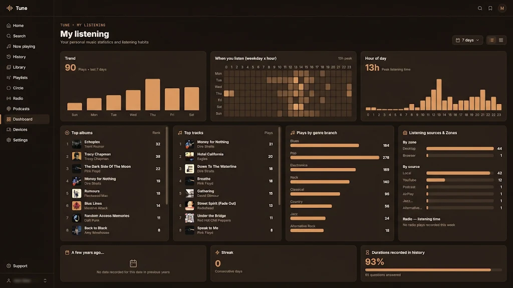
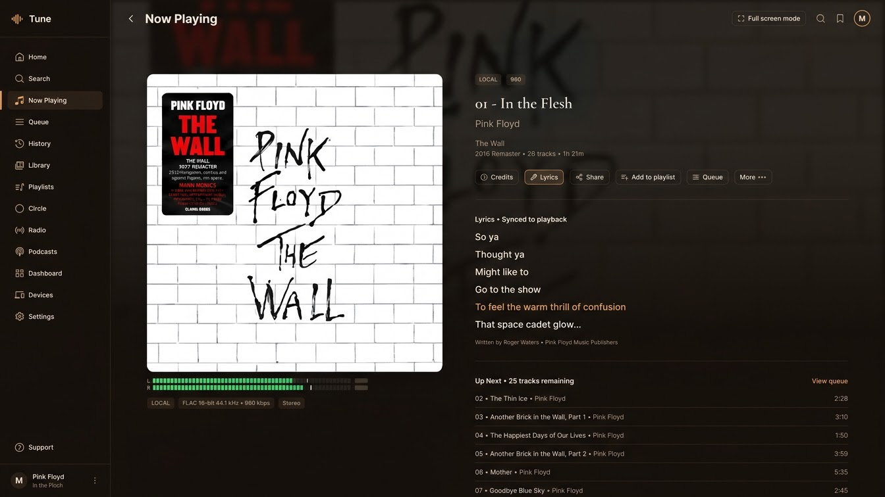
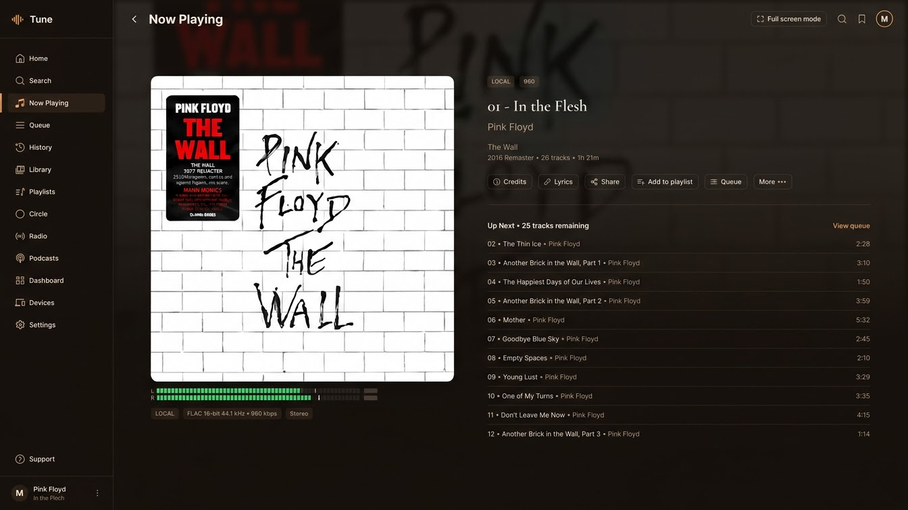

# Tune Design Reference — v3

The design reference for the Tune web client (the "V2" shell). It supersedes `Tune_design_v2.md` and retains its code-derived baseline from `tune-web-client` (`main`, 20 November 2026). **V3 specifies the Dashboard redesign in §9 and the Now Playing redesign in §10.** Existing code remains authoritative for data and behavior. The V3 changes are a specification for implementation.

Stack: **Svelte 5 + TypeScript, plain scoped CSS, Lucide for Svelte icons.** Tune uses no Tailwind or UI kit. Tokens live in three stylesheets:

| File | What it holds |
| --- | --- |
| `src/styles/tune-v2.css` | All `--v2-*` tokens, the 9 themes, the shared screen header (`.v2-top`, `.v2-btn`, `.v2-rech`) |
| `src/styles/tune-theme.css` | Legacy `--tune-*` / `--font-*` / `--space-*` / `--radius-*` / layout variables, global reset, scrollbars, kiosk mode |
| `src/styles/vue-mini.css` | The phone-sized "mini view" layout (`.v2-shell.mini`) |
| `src/lib/v2Theme.ts` | The theme list (ids, labels, swatches) |

---

## 1. How to use this file with an AI

For Dashboard, start with [§9](#9-dashboard-redesign--my-listening). For Now Playing, start with [§10](#10-now-playing-redesign). Keep the accompanying reference images next to this file. Use the rest of the document for shared design conventions.

1. **Reuse the Tune design system.** Use the CSS variables of §2 and choose UI icons from the Lucide Svelte pack as described in §3. Start with the shared components in §4 and verify additional screen-specific components in the repository.
2. **Use Lucide as the UI icon library.** Keep other dependencies within the existing stack. Avoid additional icon packs, fonts, unloaded font weights, raw colours, gradients that bypass tokens, CSS frameworks, and unrelated JavaScript dependencies.
3. **No raw colours in components.** Write `var(--v2-…)`. Two of the nine themes are light: a hard-coded dark hover becomes a black stain there.
4. **Apply explicitly approved screen changes.** Follow §9 for Dashboard and §10 for Now Playing, including their documented deviations. On other screens, preserve the existing app where a mock-up differs, and report the difference in a short "Deviations" list.
5. **One page (one tab) at a time.** Finish, compare, then move on.
6. **Compare against a reference screenshot** of the current screen (same theme, same width: 1440 px and 390 px) before proposing changes. The before/after captures of draft PR `renesenses/tune-web-client#3298` are the current references for Tune Circle.
7. **Never invent data** ("aucune donnée inventée"). Production numbers and entities come from the app’s real data and existing derived metrics. Tune Circle’s data and visibility rules are in §6. The personal Dashboard has real play counts and uses the compact empty states in §9.
8. **Every UI string is translated** through the existing i18n pipeline. Use the locale list in the checked-out repository. Design for labels 40 % longer than English, and for CJK and Greek glyphs. Never bake text into images.
9. **Every font size is scaled**: write `calc(Npx * var(--v2-txt-echelle, 1))`, never a bare `font-size: 13px`. The user can pick Small (0.9), Normal (1) or Large (1.15) text in Settings.
10. **Respect `prefers-reduced-motion`** (no animation, static globe) and keep visible keyboard focus.
11. **Do not touch** the bottom player (`TransportBar`), the sidebar, or the top-right cluster (search, bookmark, avatar) unless the brief explicitly says so.
12. If a rule here looks wrong, **flag it** in §7 terms ("known inconsistency"); do not fix it on your own. Bertrand decides.

---

## 2. Design tokens

### 2.1 Themes

The V2 client has **nine themes**, chosen in Settings and set as `data-v2-theme` on `<html>`. Tokens are scoped to `.tune-v2` (every V2 screen root and the shell carry that class).

| id | Label in the app | Kind | Background / accent swatch |
| --- | --- | --- | --- |
| `black-green` | Noir / Vert (Black / Green) — **default** | dark | `#071418` / `#00D4AA` |
| `black-blue` | Noir / Bleu (Black / Blue) | dark | `#06111A` / `#00BCD4` |
| `midnight-orange` | Minuit / Orange (Midnight / Orange) | dark | `#0B1020` / `#FF8A3D` |
| `mozaiklabs` | Mozaiklabs (anthracite, orange gradient) | dark | `#1E1F22` / `#F97316` |
| `mozaiklabs-logo` | Mozaiklabs (logo) — pure black, green mosaic | dark | `#000000` / `#2A9F5B` |
| `brown` | Brun (Brown) — **the theme of the Circle mock-ups** | dark | `#17110D` / `#D89A63` |
| `dark-grey` | Gris foncé (Dark grey) — neutral grey | dark | `#2B2B2B` / `#3DD6B0` |
| `clear-white` | Clair / Blanc (Light / White) | light | `#FFFFFF` / `#007C66` |
| `clear-grey` | Clair / Gris (Light / Grey) | light | `#EDEFF2` / `#356C88` |

Plus **"Mon thème" (My theme)**: a user-made theme (plugin `mon-theme`) that sets 20 of the `--v2-*` colour tokens, validated for WCAG AA. A design that uses only tokens works with it automatically; a hard-coded colour does not.

The legacy `data-theme` themes in `tune-theme.css` (default dark, light, oled, midnight) belong to the **old** client. Do not design for them.

### 2.2 Colour tokens — values per theme

Abbreviations: BG = black-green, BB = black-blue, MO = midnight-orange, MZ = mozaiklabs, ML = mozaiklabs-logo, BR = brown, DG = dark-grey, CW = clear-white, CG = clear-grey.

**Surfaces, lines, text**

| Token | Use | BG | BB | MO | MZ | ML | BR | DG | CW | CG |
| --- | --- | --- | --- | --- | --- | --- | --- | --- | --- | --- |
| `--v2-bg` | Page background | #071418 | #06111A | #0B1020 | #1E1F22 | #000000 | #17110D | #2B2B2B | #FFFFFF | #EDEFF2 |
| `--v2-bg2` | Second background band | #0A1A1F | #0A1822 | #10162B | #222326 | #080A09 | #1F1712 | #2F2F2F | #F6F8FA | #E6E9ED |
| `--v2-surface` | **Floating surface**: cards, menus, modals | #1B2432 | #1A2333 | #1A2138 | #2D2F33 | #1F2321 | #2A211A | #383838 | #FFFFFF | #FFFFFF |
| `--v2-surface2` | **Choice surface**: inputs, chips, panels, option lists, avatar fill | #101B23 | #0F1A26 | #151C33 | #26282B | #151817 | #251D16 | #323232 | #F1F4F7 | #E2E6EB |
| `--v2-line` | Hairline borders, list separators | #1C2634 | #1A2434 | #212A44 | #34363B | #2B302D | #2E2419 | #3A3A3A | #E4E9EE | #D6DBE1 |
| `--v2-line2` | Stronger borders (buttons, inputs) | #243040 | #223044 | #2C3654 | #42454B | #3A413D | #3D3024 | #474747 | #D2DAE2 | #C2C9D1 |
| `--v2-txt` | Primary text | #FFFFFF | #FFFFFF | #F5F7FF | #F4F4F5 | #FFFFFF | #F7EFE6 | #F2F2F2 | #0C1620 | #141C24 |
| `--v2-txt2` | Secondary text | #8E9AA8 | #8C99AA | #9AA3C0 | #C4C6CC | #D2D8D5 | #B49E88 | #C2C2C2 | #56646F | #515C67 |
| `--v2-txt3` | Muted text (meta, timestamps); ≥ 4.5:1 on every surface | #7D8EA1 | #7C8DA5 | #818AA9 | #A3A6AE | #A9B1AD | #9E8870 | #A6A6A6 | #646E78 | #5F6770 |

The three planes are deliberately ordered: background 1.00 → choice surface ≈ 1.07–1.13 → floating surface ≈ 1.19–1.21 (luminance contrast ratios). Do not swap `surface` and `surface2`.

**Accent and states**

| Token | Use | BG | BB | MO | MZ | ML | BR | DG | CW | CG |
| --- | --- | --- | --- | --- | --- | --- | --- | --- | --- | --- |
| `--v2-acc1` | Accent: selected tab underline, key icons, unread dot, start of gradients; usable as text | #00D4AA | #00BCD4 | #FF8A3D | #F97316 | #2A9F5B | #D89A63 | #3DD6B0 | #007C66 | #356C88 |
| `--v2-acc2` | Gradient end, hover/focus border. **Fill/line only** (not always 4.5:1 as text) | #50AD6F | #2E7DF6 | #FFB347 | #EA580C | #28BA9B | #B5744A | #62B886 | #008199 | #427D96 |
| `--v2-acc-tint` | Accent-tinted text on dark (hover text of outline buttons, "Invite" label) | #DFFFEF | #DFF4FF | #FFE3C7 | #FFE4D0 | #E4F9D8 | #FFE2C4 | #DFFFEF | #00695A | #1F4A5C |
| `--v2-on-acc` | Text/icons on an accent fill or gradient | #04121A | #04121A | #1A0E02 | #1A0A02 | #000000 | #1A0F06 | #101010 | #FFFFFF | #FFFFFF |
| `--v2-hover` | Row / item hover background | #0E1A22 | #0D1A26 | #151D36 | #292B2E | #101312 | #241B14 | #313131 | #EDF1F5 | #E4E8ED |
| `--v2-active1` / `--v2-active2` | Selected sidebar item (90° gradient) | #0F2029 / #0C1820 | #0E1F2E / #0B1622 | #1A2340 / #121A32 | #3A2619 / #2C2018 | #0F2A1B / #0A1A12 | #2A2018 / #201812 | #373737 / #303030 | #E6F5F1 / #DEEFEB | #DBE3EA / #D3DCE4 |
| `--v2-player1` / `--v2-player2` | Player bar background pair | #0B141B / #08121A | #0A131D / #07111A | #0E1428 / #0A0F20 | #1A1B1E / #17181B | #050606 / #000000 | #1E1611 / #17110D | #262626 / #232323 | #FFFFFF / #F3F6F9 | #F4F6F8 / #E9ECF0 |
| `--v2-knob` | Slider knob | #FFFFFF | #FFFFFF | #FFFFFF | #F4F4F5 | #FFFFFF | #F7EFE6 | #F2F2F2 | #0C1620 | #141C24 |
| `--v2-av1` / `--v2-av2` | Placeholder / avatar fills | #334155 / #556070 | #31405A / #4E6180 | #3A4166 / #565F8C | #46484E / #666970 | #2F3632 / #4C554F | #4A3B2C / #6B5540 | #4A4A4A / #666666 | #C3CDD6 / #9AA8B4 | #B8C1CB / #93A0AC |
| `--v2-danger` | Destructive text/icon | #FF8080 | #FF8080 | #FF8080 | #FF8F87 | #FF8F87 | #FF9B8A | #FF8F87 | #C0392B | #B3382B |
| `--v2-danger-bd` | Destructive border | #FF6B6B | #FF6B6B | #FF6B6B | #FF6B6B | #FF6B6B | #E8735C | #FF6B6B | #E05A4A | #D45444 |
| `--v2-danger-soft` | Destructive background tint | danger at 12 % (10 % on light themes) | | | | | | | | |

**Glows, focus, scrims, shadows**

| Token | Use | Dark themes | Light themes |
| --- | --- | --- | --- |
| `--v2-glow` / `--v2-glow-strong` | Ambient glow around accent elements (globe halo, play button) | accent at 20–26 % / 26–32 % | accent at 20 % / 26 % |
| `--v2-acc-soft` | Very light accent wash (hover of outline accent buttons) | acc2 at 10–12 % | 9–10 % |
| `--v2-focus` | Focus ring colour (3 px box-shadow) | accent at 14–22 % | 22–24 % |
| `--v2-scrim` | Overlay behind sheets/drawers, play button over a cover | bg at 80 % | white/grey at 85 % |
| `--v2-sh-sm` | **A colour, not a shadow** (small shadow tint) | rgba(0,0,0,.35–.55) | rgba(16,32,48,.14) |
| `--v2-sh-card` | Card shadow | `0 6px 16px rgba(0,0,0,.30–.60)` | `0 4px 12px rgba(16,32,48,.10)` |
| `--v2-sh-lg` | Bottom sheets, large panels | `0 16px 40px rgba(0,0,0,.45–.70)` | `0 12px 32px rgba(16,32,48,.16)` |
| `--v2-sh-menu` | Dropdown menus | `0 20px 50px rgba(0,0,0,.50–.75)` | `0 16px 40px rgba(16,32,48,.20)` |

Exact per-theme values are in `src/styles/tune-v2.css`; copy them from there, never re-derive.

**Meaning colours (never repainted with the theme)**

| Token | Use | Dark | Light |
| --- | --- | --- | --- |
| `--v2-canal-g` / `--v2-canal-d` / `--v2-canal-tous` | Parametric EQ: left / right / both channels | #5AA9FF / #FF6B8B / #F2C14E | #1F5FBF / #B4235A / #8A6200 |
| `--v2-crete-vert` / `-ambre` / `-rouge` | Peak meter OK / warning / clip | #4ade80 / #fbbf24 / #ef4444 | #16a34a / #b45309 / #c0392b |
| `--v2-crete-fond`, `-ppm`, `-eteint`, `-libelle` | Peak meter rail, PPM mark, off lamp, labels | white at 6 / 85 / 12 / 55 % | ink at 10 / 80 / 18 / 62 % |
| `--v2-vu-face-h` / `-face-b` / `-bord` / `-encre` / `-rouge` / `-aiguille` / `-lueur` | Needle VU meter (canvas): face gradient, border, ink (RGB triplet), red zone (triplet), needle, needle glow | ivory ink, needle #f2b441 | grey ink, needle #B45309 |
| `--v2-puce-tidal`, `-qobuz`, `-deezer`, `-spotify`, `-youtube`, `-amazon`, `-bandcamp`, `-upnp`, `-local` | Source badges (`ServiceBadge`), darkened on light themes only | component defaults | #006A6E, #264E9C, #7329B8, #0D6230, #A3221B, #005A7D, #0D5B70, #7D4A00, #434C57 |
| `--tune-success` / `--tune-warning` / `--tune-danger` | Status (legacy, deliberately not bridged) | #10b981 / #f59e0b / #ef4444 | same |

**Other tokens**

| Token | Value | Use |
| --- | --- | --- |
| `--v2-scrollthumb` | #808C98 (CW), #737F8B (CG); undefined on dark | Scrollbar thumb on light themes |
| `--v2-body-bg` | = `--v2-bg` of the theme, on `:root` | `<body>` background (overscroll) |
| `--v2-grappe-w` / `--v2-grappe-h` | 172px / 66px fallback, **measured live** by `ShellV2` | Right/top reserve for the floating top-right cluster. Headers use `padding-right: var(--v2-grappe-w, 172px)` |
| `--tune-*` (bg, surface, surface-hover, footer, text, text-secondary, text-muted, border, accent, accent-hover, accent-2, text-dim, grey2) | bridged to `--v2-*` inside `.tune-v2` | Lets legacy components (player, Now Playing) follow the V2 theme. Do not use `--tune-*` in new V2 work |

### 2.3 Typography

**Fonts actually loaded** (`index.html`, Google Fonts): **Cormorant Garamond** 400, 600, 700 + italic 400 · **Inter** 400, 500, 600, 700 · **Lato** 300, 400, 700. Nothing else. **Roboto is not used** (it only appears as a system fallback name).

| Token | Stack | Role |
| --- | --- | --- |
| `--font-display` → `--v2-police-titre` | `'Cormorant Garamond', Georgia, serif` | **Editorial titles**: Tune Circle title, Home title, album and artist titles, Circle card headings, big stat numbers. Greek falls back to Georgia |
| `--v2-sans` → `--v2-police-texte` | `'Inter', system-ui, -apple-system, 'Segoe UI', Roboto, sans-serif` | **All UI text** of V2 screens (screen roots set it). CJK falls to the system font |
| `--v2-mono` | `'Roboto Mono', ui-monospace, SFMono-Regular, Menlo, monospace` | Technical values (formats, sample rates, counts in chips), eyebrows, small uppercase labels. Roboto Mono is **not loaded** — see §7 |
| `--font-body` / `--font-primary` | `'Lato', -apple-system, …` (Inter for Vietnamese and Greek) | Legacy body font: `<html>/<body>` default, shared/legacy components (player, Now Playing, toasts) and **Circle messaging text** — see §7. Do not use in new V2 work |
| `--font-label` | `'Inter', …` | Legacy labels |

Rule: **two families per screen**: Cormorant Garamond for editorial headings, Inter for everything else; mono only for technical values and micro-labels. Use the tokens, never a family name.

**Type scale actually in use** (all written `calc(Npx * var(--v2-txt-echelle, 1))`):

| Role | Size / weight / family | Where |
| --- | --- | --- |
| Hero title | 46 / 600 (album) or 500 (artist), line-height 1.08, serif | `AlbumDetailV2`, `EnTeteArtiste` |
| Home title | 36 / 600, serif | `PageWidgets` (`.accueil .v2-top h1`) |
| Circle title | 34 / 600, line-height 1.1, letter-spacing -0.01em, serif | `CircleV2` `.titre-circle` |
| Big stat number | 34 / 600 serif (`PanneauStats`); 24 / 700 Inter (Circle counters) | `ligne1/PanneauStats`, `DecouvrirCercleV2` |
| Screen title (standard header) | 30 / **800**, letter-spacing -0.01em, Inter | `.v2-top h1` (all other screens); 18 / 700 in mini view |
| Banner heading | 26 / 600 serif | `PlaylistsGrilleCercleV2` |
| Section heading | 22 / 600 serif (Home sections); 19 serif (Messages list title) | `PageWidgets`, `MessagerieCercleV2` |
| Card heading | 17 / 600 serif | Circle cards (`.carte-dec h2`, `.pl-own h3`, shared-in-thread) |
| Block heading | 15 / 700 Inter | Circle management blocks (`.bloc h2`) |
| Circle subtitle | 15 serif, `--v2-txt2` | "People. Music. A more connected world." |
| Eyebrow | 13 / 600 mono, letter-spacing .06em, `--v2-acc1` | `.v2-eyebrow` above screen titles |
| Subtitle under title | 13.5, `--v2-txt2`, max 60ch | `.v2-sous` |
| Nav item | 13.5 / 500 | Sidebar |
| Tabs, chips | 13–14 / 600 | `.tab` 14, `.chip` 13.5, Circle `.onglet` 13 |
| Body / list text | **13** (most common), 12, 12.5 | Rows, cards, inputs (13), buttons (12.5 / 600) |
| Meta / notes | 11–11.5, `--v2-txt3` | Timestamps, captions, counter labels |
| Micro labels | 9.5–11, often mono uppercase with letter-spacing .06–.18em | Sidebar group labels (9.5, .18em), form labels (11 mono uppercase), badges (10 mono .16em) |

Weights in use: **600** (dominant), 700, 500, 400; 800 only for the standard screen `h1`; 300 once (the "+" of the add-member avatar). Use `font-variant-numeric: tabular-nums` for counters, durations and times (already used in ~30 places).

Sentence case for titles, buttons and labels. Uppercase exists **only** in mono micro-labels and badges.

### 2.4 Spacing

Legacy scale (`tune-theme.css`): `--space-xs` 4 · `--space-sm` 8 · `--space-md` 16 · `--space-lg` 24 · `--space-xl` 32 · `--space-2xl` 48 (halved on the 800×480 kiosk screen).

Values the V2 screens really use — match them when extending an existing screen:

| Where | Value |
| --- | --- |
| Screen header `.v2-top` padding | 24px top, 30px sides, 14px bottom; right = `--v2-grappe-w` |
| Page side gutter (desktop) | 30px (12px in mini view) |
| Gap between cards / grid cells | 18px (Circle Discover), 16px (sections, playlist grids) |
| Card padding | 16px vertical × 18px horizontal |
| Header action group gap | 10px; gap between tabs 4px |
| Filter row | gap 12px, padding 16px 30px 14px |
| List row | 8px vertical (cards), 12px 8px (conversation rows), gap 10px |
| Bottom reserve in scroll areas | ~110px (room for the 60px "back to top" button above the player) |

For **new** spacing with no precedent, use multiples of 4 from the legacy scale. Do not round existing 18/30/14/10 values (see §7).

### 2.5 Radii

| Token | Value | Use |
| --- | --- | --- |
| `--v2-r-card` | **4px** | Cards, panels, modals, conversation pane, dialogs |
| `--v2-r-md` | 12px | Large tiles, thumbnails |
| `--v2-r-pill` | 20px | Buttons (`.v2-btn`), chips, pill tabs, search field, sidebar nav items, toggles |
| `50%` | — | Avatars, round icon buttons, dots |
| Message bubbles | 16px with one 4px corner (16 16 16 4 incoming, 16 16 4 16 outgoing) | `MessagerieCercleV2` |
| Bottom sheet | 16px 16px 0 0 | Mini-view filter sheet |
| Legacy `--radius-sm/md/lg/xl` | 4 / 6 / 8 / 12 | Legacy components |

v1's "8px buttons, 12px cards" is **wrong for Tune**: cards are 4px, buttons are pills.

### 2.6 Shadows and depth

Depth comes first from the surface planes (bg → surface2 → surface) and 1px borders (`--v2-line`, `--v2-line2`). Shadows: `--v2-sh-card`, `--v2-sh-lg`, `--v2-sh-menu` only. Glow: `--v2-glow` / `--v2-glow-strong`. Gradients: only `linear-gradient(135deg, var(--v2-acc1), var(--v2-acc2))` (primary fills, active pills, avatar of "me") and the 90° `--v2-active1 → --v2-active2` of the selected sidebar item.

### 2.7 Z-index layers (existing — pick one, do not invent)

| Layer | z-index |
| --- | --- |
| Local stacking inside a component | 1–10 |
| Top-right cluster (search, bookmark, avatar) | 80 |
| Shell dialog backdrop | 90 |
| Mini-view filter sheet backdrop / sheet | 94 / 95 |
| Sidebar drawer (≤ 760px) | 120 |
| Top-right cluster above the drawer (≤ 760px) | 121 |
| Now Playing full-screen overlay | 122 |
| Toasts | 200 |
| Modals, "…" object menus (backdrop 900 / panel 901), back-to-top button | 900 / 901 |
| Dialog container (confirmations) | 1500 |
| Truncated-text tooltip (`bulleTexte`) | 2000 |

### 2.8 Breakpoints

| Width | What changes |
| --- | --- |
| ≤ 1400px | Circle Discover: right column (counters, "New on Tune Circle") moves under the globe |
| ≤ 1024px | Frequent component breakpoint (legacy sidebar collapses) |
| ≤ 1000px | In-screen search loses its fixed 260px width |
| ≤ 779px | In-screen search takes a full row under the title; tabs and buttons wrap below |
| **≤ 760px** | **Phone layout**: sidebar leaves the grid and becomes an overlay drawer (`min(280px, 86vw)`); one column |
| ≤ 768px | Player switches to its compact height (56px) |
| ≤ 640px | Most common component breakpoint (grids, cards) |
| `(hover: none)` | Hover-only controls (e.g. play button on a cover) are always visible |
| 840 × 520 | Kiosk touchscreen: halved spacing, 44px minimum targets |

The **mini view** (`?vue=mini`, used by the desktop widget ≈ 380px) is selected by URL, not by width: one-line header (18px title, eyebrow and subtitle hidden), horizontally scrolling tabs, filters in a bottom sheet, 2-column grid.

### 2.9 Motion

- Transitions: **0.12–0.18s**, mostly `.15s` (colour, border) and `.18s ease-out` (header padding when the search opens). `fadeIn` 0.3s, `pulse` 2s for live indicators.
- `@media (prefers-reduced-motion: reduce)`: animations off (24 files handle it). The Circle globe renders a **still frame**.
- The sidebar drawer does **not** slide (it toggles `display`) — a deliberate fix of a Chrome transition bug. Do not add a slide-in.
- Canvas animations (globe, VU meters) stop when the tab is hidden; the Circle globe redesign (#3298) also stops off-screen and caps at ~30 fps and DPR 2.

---

## 3. Icons

**Lucide is Tune’s UI icon source.** For any new or replaced UI icon, reuse an existing shared Tune icon component when it represents the same action. Otherwise pick the closest semantic match from the Lucide catalog and import just that Svelte component. Reuse the same glyph for the same action across screens. Avoid copying SVG paths, drawing an equivalent by hand, or importing the whole catalog.

- **Package.** Use the Lucide Svelte dependency already present in the checkout. The current official package is `@lucide/svelte`. If the checkout already uses the older `lucide-svelte` package, follow its existing import style and keep one Lucide dependency. If Lucide is absent, add `@lucide/svelte` using the repository’s package manager and update its lockfile. [Official Lucide Svelte guide](https://lucide.dev/guide/svelte/) · [Lucide icon catalog](https://lucide.dev/icons/)
- **Rendering.** Lucide components render inline SVG. Let the icon inherit `currentColor` and apply accents to the parent with the existing theme tokens. Use explicit per-icon imports and a local map of those imports when a widget selects icons dynamically.
- Stroke width: **1.8** for navigation and most UI icons (sidebar), **1.7** for Circle tab icons, **2** for small action glyphs (play, close, chevrons). Do not mix filled and outline styles in one row; a filled shape is reserved for state (e.g. a filled heart = favourite).
- Sizes: **16px** in buttons, search fields and the top-right cluster; **17px** in the sidebar; 12–14px in chips; 10px for the clear "×" in search; 22px for the Now Playing close button.
- Accessibility: decorative SVG gets `aria-hidden="true"`; an icon-only button must have an `aria-label` (and a tooltip when the meaning is not obvious).
- Emoji appear only as **user content** (messages, a shortcut icon the user picked) — never as interface icons. The ⓘ of `AideInfo` is the one text glyph used as a control.

Example for `@lucide/svelte`:

```svelte
<script lang="ts">
  import CalendarDays from '@lucide/svelte/icons/calendar-days';
</script>

<CalendarDays size={16} strokeWidth={1.8} aria-hidden="true" />
```

Existing Tune icon locations for matching action semantics and styling. Older inline icons can remain in untouched components.

| Example | File |
| --- | --- |
| Sidebar navigation icons (path strings in a data array, ~line 115; rendered ~line 1022) | `src/components/v2/Sidebar.svelte` |
| Circle tab icons (globe, speech bubble, playlist, people) ~line 745, "invite" icon ~line 734 | `src/components/v2/CircleV2.svelte` |
| Track actions (play, play next, heart, more) ~line 574 | `src/components/v2/PisteActions.svelte` |
| Settings gear, server state | `src/components/v2/IconeReglages.svelte`, `IconeEtatServeur.svelte` |
| Zone/device type icons | `src/components/partages/ZoneTypeIcon.svelte` |
| Demo icon helper (4 Circle icons, same stroke) — draft branch only | `src/demo/cercleLevente/Icone.svelte` in PR #3298 |

---

## 4. Components

All V2 components are in `src/components/v2/`, shared ones in `src/components/partages/`. Reuse before creating. Every interactive component needs default, hover, focus-visible, disabled, selected/active, loading, empty and error states.

### 4.1 Shared CSS patterns (in `tune-v2.css`, used as classes)

| Class | Role | Variants / states | Use it for |
| --- | --- | --- | --- |
| `.v2-top` > `.v2-titres` (`.v2-eyebrow`, `h1`, `.v2-sous`) + `.v2-actions` | The **screen header**: title left; search, secondary actions, then the single primary action pushed right | Wraps at ≤ 779px; mini view one line | Every screen header. Order: search → secondary → primary (last) |
| `.v2-btn` | **The** action button: height 38, pill, 1px `--v2-line2` border, transparent, 12.5/600, 16px icon, gap 8 | hover: border `--v2-acc2`, text `--v2-acc-tint` · focus: border acc2 + `0 0 0 3px var(--v2-focus)` · disabled: opacity .45 | Secondary actions |
| `.v2-btn.primaire` | Primary: accent gradient fill, `--v2-on-acc` text, 700 | hover: brightness 1.06 | **One per screen** |
| `.v2-btn.danger` | Destructive: `--v2-danger` text, `--v2-danger-bd` border | — | Delete, leave, remove (with confirmation) |
| `.v2-rech` | In-screen search: 260px, height 38, pill, `--v2-surface2`, 16px magnifier at left 13px, clear button `.clr` | focus: border acc2 + focus ring; shrinks ≤ 1000px; full row ≤ 779px | Prefer the `ChampRecherche.svelte` component |

### 4.2 Layout and navigation

| File | Role | Notes |
| --- | --- | --- |
| `ShellV2.svelte` | App shell: update banner, sidebar + main grid, player, top-right cluster | Update banner `.maj`: 42px, accent gradient, `--v2-on-acc` text |
| `Sidebar.svelte` | Left navigation | 236px, collapsible to 72px (icons only); ≤ 760px overlay drawer. Item: pill, 13.5/500, 17px icon, gap 12; hover `--v2-hover`; active = `--v2-active1→2` gradient + inset `--v2-line2` ring + accent icon. Group labels 9.5px, .18em |
| `partages/TransportBar.svelte` | **Bottom player** | 90px desktop, 56px ≤ 768px; three thirds (track / controls + progress / device + volume). Now Playing omits it from its route layout per §10. |
| `AvatarMenu.svelte` | Avatar menu, top-right (interface level Essential/Advanced/Expert) | Part of the floating cluster |
| `partages/GlobalSearchBar.svelte` | Global search in the cluster (32px round button, expands) | Not the in-screen search |
| `FlechesNavigation.svelte` | Back / forward arrows in headers | `aria-disabled` at the ends |
| `RemonterEnHaut.svelte` | Single "back to top" button, 60px round, z 900 | Leave 60px free bottom-right |
| `mini/` | Mini-view pieces (bottom tab bar, banner) | URL-driven phone layout |

### 4.3 Tabs, chips, filters, toggles

| Pattern / file | Role | Variants / states |
| --- | --- | --- |
| Pill tabs `.tab` (e.g. `LibraryV2`) | Section switch inside a screen header | 8px 15px, pill, 14/600, `--v2-txt2`; active = accent gradient + `--v2-on-acc` |
| Underline tabs `.onglet` (`CircleV2`) | The 4 Tune Circle tabs (Discover, Messages, Shared playlists, My circle) | 16px icon + label, 13/600, 12px 16px; selected = `--v2-txt` + 2px `--v2-acc1` bottom border; badge `.pastille-onglet` (18px, accent fill); ARIA tabs with arrows/Home/End (`lib/circleOnglets.ts`) |
| Chips `.chip` | Filters | 36px, pill, `--v2-surface`, 13.5/600, `--v2-txt2`; active = accent gradient; `.chip.count` outlined; mono count `em` |
| `RadioChipsGenres.svelte` | Genre chips for radios | — |
| `BasculeAffichage.svelte` | Grid / list view toggle | Rotates modes |
| Filter bottom sheet (mini view) | `.filters` moved into a sheet opened by "Filters" | `--v2-surface2`, 16px top radius, `--v2-sh-lg` |

### 4.4 Buttons with menus, actions

| File | Role |
| --- | --- |
| `BoutonLectureV2.svelte` | Split Play button (play + ▾ menu: play next, add to queue) on album/collection/playlist pages |
| `BoutonMenuV2.svelte` | Button that opens a header menu ("…", "Sort ▾", "+ New") |
| `MenuObjetV2.svelte` | "…" menu of an object (album, artist, playlist, collection, label); backdrop z 900, panel 901 |
| `MenuPisteV2.svelte`, `PisteActions.svelte` | Track row menu and inline actions |
| `PochetteActions.svelte` | Actions over a cover (play, menu) |
| `partages/HeartButton.svelte` | Favourite toggle (outline → filled) |
| Round icon button (`.raccourci` in the shell) | 32px circle, `--v2-surface2`, 16px icon — needs `aria-label` |

### 4.5 Lists, cards, media, avatars

| File / pattern | Role | Notes |
| --- | --- | --- |
| `ListePistesV2.svelte` | Track list | With `IndicateurLecture.svelte` (now-playing marker, not colour only) |
| Circle card `.carte-dec` (`DecouvrirCercleV2`) | Content card | 16px 18px padding, 1px `--v2-line`, `--v2-r-card` (4px), `--v2-surface`; heading 17 serif; "View all" link 12/600 `--v2-txt2` |
| List row `.rang` | Row inside a card | 8px vertical, gap 10, bottom hairline (none on last); button rows hover `--v2-hover` |
| `partages/AlbumArt.svelte` | Cover image with fallbacks | Always use it for covers |
| `MosaiquePochettes.svelte` | Playlist cover = 2×2 mosaic (always four cells) | — |
| `VignettePochettesCercle.svelte` | Circle playlist tile: mosaic of resolvable covers over a theme-coloured tile (accent gradient), lazy-loaded | Fallback = the tile, never stock art |
| `CarteDecouverte.svelte` | Discovery map for radios/podcasts (genres → countries → items) | Nodes are real buttons |
| Avatar `.avatar` | **Initials only** (`initiales()` in `lib/circleHabillage.ts`) | 36px circle, `--v2-surface2`, 1px `--v2-line2`, 12/700 `--v2-txt2`; `.grand` 60px accent gradient + `--v2-acc-tint` ring (me); `.plus` dashed "add"; `.icone` for groups |
| Unread dot `.point-non-lu` | 7px `--v2-acc1` dot | Always paired with bold text or a count |

### 4.6 Badges and pills

`partages/ServiceBadge.svelte` (source: TIDAL, Qobuz, Local…, `--v2-puce-*`), `partages/QualityBadge.svelte` (format / resolution), `BadgeTuneTested.svelte`, `PastilleCompilation.svelte`, `PastilleNotifsCercle.svelte` (unread Circle notifications next to the sidebar entry; hidden at zero or when unsupported), `partages/VersionJoueePastille.svelte`, `BadgeHorsBackend.svelte`.

### 4.7 Fields

| File / pattern | Role |
| --- | --- |
| `ChampRecherche.svelte` | **The** in-screen search (one component for all screens: clear button, Esc, placement rule) |
| Text input (pattern) | Height 38, `--v2-surface2` (or `--v2-bg` inside a surface), 1px `--v2-line2`, 13–13.5px; focus border `--v2-acc2` + 3px `--v2-focus` ring. Label visible above, 11px mono uppercase `--v2-txt3` |
| `SelecteurEmojiV2.svelte`, `SuggestionEmojiV2.svelte` | Emoji picker / suggestions in the message composer |

### 4.8 Banners, modals, drawers, feedback

| File | Role |
| --- | --- |
| `BandeauReinstallerGreffons.svelte`, `AlertePareFeu.svelte`, `AlertePlafondIaV2.svelte`, `partages/OutputModuleBanner.svelte`, `partages/BandeauDonneesNonPersistantes.svelte` | In-page banners (information, warning, action) |
| `RenommerModale.svelte`, `AssocierAlbumModale.svelte`, `RemplacerIndisponibleModale.svelte` | Modals: `min(420px, 100%)`, `--v2-surface`, `--v2-r-card`, 28px close button top-right, backdrop, z 900 |
| `partages/DialogContainer.svelte` | Confirmation dialogs (destructive actions), z 1500 |
| `partages/TiroirLateral.svelte` | Right-hand drawer (track tags, credits) |
| `partages/ToastContainer.svelte` | Toasts, z 200 (announced to assistive tech) |
| `AideInfo.svelte` | ⓘ help: opens on hover, focus or click, Esc closes; text linked by `aria-describedby` |
| `bulleTexte` (`lib/infobulleTexte.ts`) | Keyboard tooltip for truncated text |

Loading today is a quiet text line (`.state`, 13px `--v2-txt3`); there are **no skeleton components** yet (see §7).

### 4.9 Tune Circle

| File | Role |
| --- | --- |
| `CircleV2.svelte` | The Circle page: serif title (34) + serif subtitle, outlined accent **Invite** button (36px pill, 1px `--v2-acc1`, `--v2-acc-tint` text, hover `--v2-acc-soft`), the 4 underline tabs, management blocks (invite, contacts, circles, invitations received/sent, shared with me) |
| `DecouvrirCercleV2.svelte` | Discover tab: hero with the globe scene, counters card, "New on Tune Circle", recent messages, members row, shared playlists strip, recent activity. Hides any block without data |
| `SceneCercleV2.svelte` + `src/lib/champCercle/*` | The globe / network scene: **Canvas 2D** (no WebGL). Views World, Solo, Link, Network, Genres; zoom, borders, "Show my city", public map. Labels are DOM nodes |
| `MessagerieCercleV2.svelte` | Messages tab: conversation list (filters All / Direct / Groups) + thread + composer; shared-in-thread list |
| `PartageMessageV2.svelte` | Share music into a conversation |
| `CarteThemeCercleV2.svelte` | A "My theme" card sent in a thread (colour preview + Apply) |
| `CerclesGenerauxV2.svelte` | Public "general circles" catalogue (period, genre, label, artist): join, leave, write |
| `PlaylistsGrilleCercleV2.svelte` | Shared playlists tab: banner, filters, sort, grid/list, "Your playlists" |
| `PlaylistCercleV2.svelte`, `PlaylistsCercleSection.svelte`, `AjoutPlaylistCercleV2.svelte`, `AjoutGroupeCercleV2.svelte` | Playlist detail, section, add-to-playlist, add many |
| `InviterSansEmailV2.svelte` | Invite without e-mail |
| `NotificationsCercleV2.svelte` | Notification list and settings |
| `LectureSeuleCercleV2.svelte` (+ `lib/circleDroits.ts`, `cercleLectureSeule`) | Read-only mode: actions are hidden or disabled with an explanation |

**Globe redesign:** the proposed "glowing dot sphere" (warm halo, dotted land, glowing member cities, 2 labelled members, list equivalent for screen readers) is in draft PR **#3298** (`demo/circle-levente-8df74e`, not merged). It reads its colours from `--v2-acc1`, `--v2-acc-tint`, `--v2-glow`, `--v2-surface`, `--v2-bg` and reuses `champCercle/globe.ts` and `pointsTerre.ts`. Use its captures as the visual reference; the current globe's controls are meant to move into a secondary panel.

---

## 5. Layout

- **Shell grid**: optional update banner (42px) on top; then a row `grid-template-columns: auto 1fr` (sidebar + main); the player below spans the full width. The main area is `position: relative` and clips; screens scroll inside themselves.
- **Sidebar**: 236px (72px collapsed, icons only, manual toggle). ≤ 760px: hidden; opens as an overlay drawer `min(280px, 86vw)` with labels, z 120, over a scrim.
- **Top-right cluster** (global search, bookmark, avatar): absolutely positioned 20px from the top, 30px from the right (14/14 on phones). Every header reserves `padding-right: var(--v2-grappe-w, 172px)` — never hard-code that reserve.
- **Bottom player**: 90px (56px ≤ 768px). Screens must leave room for it and for the 60px back-to-top button (~110px bottom padding in scroll areas). Never overlap it.
- **Content widths**: page gutter 30px; Circle management blocks `max-width: 880px`; Circle scene full width; Dashboard inner content `max-width: 1100px` centred (see §9 for bands and reflow); readable text max 60ch.
- **Circle Discover**: `grid-template-columns: minmax(0, 1fr) 300px` (hero + right column, gap 18) above 1400px; one column below. Lower cards: `repeat(auto-fit, minmax(300px, 1fr))`, gap 18. Playlist strip `repeat(auto-fill, minmax(130px, 1fr))`, gap 16.
- **Grids**: album grid `repeat(auto-fill, minmax(var(--lib-pochette, 148px), 1fr))`; 2 columns in mini view.
- **Phone (390px)**: one column, sidebar in a drawer, header search on its own full row, tabs scroll horizontally (no visible scrollbar), Circle tabs scroll too, cards stack, messages show the list first then the thread with a Back control, compact player 56px, safe-area insets respected. No horizontal page scroll.
- **Touch**: `(hover: none)` shows hover-only controls. Aim for 44 × 44px hit areas on new touch controls (current sizes in §7).

---

## 6. Data rules — what Tune Circle really has

Source: `src/lib/circle.ts`, `circleMonde.ts`, `circleMessagerie.ts`, `circlePlaylists.ts`, `circleNotifications.ts`, `circleHabillage.ts` (all through the `circle` plugin, `/api/v1/ext/circle`).

**Exists**

| Area | Fields available |
| --- | --- |
| Members (contacts) | `user_id`, **name**, `since` (date the link was accepted) |
| Invitations | sent / received: name or e-mail, created, expires |
| Named circles (mine) | name, member ids (→ member count), sharing (library on/off), "members see each other" |
| Circles I belong to | circle name, owner name, audience count, "show me" |
| Location (opt-in only) | city label, country code, lat/lon **rounded to 0.5°**; off by default, only after "Show my city"; never browser geolocation or IP. Members of shared circles appear only if they also opted in |
| Public world map | anonymous points `{lat, lon}`; per-user opt-out |
| Contact library summary | only for a contact who shares their library: album count (rounded), up to 8 genres with counts; browse their albums/tracks/artists (title, artist, year, genre, format, sample rate, bit depth, duration, thumbnail) |
| Conversations | kinds **direct** (a contact), **circle** (one of my named circles; may be owner-only writing), **general** (a public general circle; pseudonym shown only after consent); unread count; last message |
| Messages | text (≤ 4000 chars, emoji allowed), optional **card** (album / track / playlist reference with cover URL and service ids, or a "My theme" card), created time, sender name in group threads, `mine` |
| General circles | name, category (period, genre, label, artist), member count, joined — no member names |
| Shared playlists | name, owner name, track count, version, `updated_at`, `mine`, can remove, circle name; covers resolved from the tracks when possible |
| Notifications | playlist shared, circle invitation, message, contact request, contact accepted, circle shared — with actor name, time, read flag |
| Counters shown | members, countries (of shown locations), shared playlists, tracks, circles — hidden when unknown or zero |
| Filters / sorts that exist | Conversations: All, Direct, Groups · Playlists: All, New (7 days), By friends, Mine · Sort: Recent, Name, Track count |

**Does not exist — never draw it**

Profile photos (initials only) · online / presence status · "last seen" · typing indicators · read receipts or delivery state · voice / video calls · reactions · file or image attachments · followers / following · plays / listens counts · trending · genre tags on shared playlists · "People to follow" · "People near you" · user bio · "Edit profile" (the existing equivalent is "Manage my visibility" = the city setting) · a "Playlists" conversation type · exact locations.

If a mock-up needs one of these, list it under "Deviations" and stop: it is a product decision for Bertrand, not a design detail.

---

## 7. Known inconsistencies — to be decided by Bertrand, do not "fix"

| # | Inconsistency | Where |
| --- | --- | --- |
| 1 | **Lato is still live**: it is the `<html>/<body>` default (`--font-primary`), the font of shared/legacy components (player `TransportBar`, Now Playing, toasts via `--font-body`) and of **Circle message text, composer and conversation previews** (`MessagerieCercleV2`, `PartageMessageV2`, `SelecteurEmojiV2`) — while V2 screens use Inter | `tune-theme.css`, those components |
| 2 | **Roboto Mono is declared but never loaded**: `--v2-mono` renders as the system monospace (SF Mono, Menlo, Consolas…), different per OS | `tune-v2.css`, `index.html` |
| 3 | **The current globe ignores the theme**: hard-coded palette (`--sc-*` in `SceneCercleV2`: gold `#deb268`, green `#4cc79d`, water `#5fa8d3`, background `#121b20`…; `COULEURS` in `champCercle/moteur.ts`). Green members on the Brown theme. Token-driven version proposed in #3298 | `SceneCercleV2.svelte`, `lib/champCercle/moteur.ts` |
| 4 | **Two title styles**: standard screens use Inter 30/800; Home, Album, Artist and Circle use Cormorant Garamond 600 | `.v2-top h1` vs `PageWidgets`, `AlbumDetailV2`, `CircleV2` |
| 5 | **Two tab styles**: gradient pill tabs (Library…) vs underline tabs (Circle) | `LibraryV2`, `CircleV2` |
| 6 | **Radii outside the tokens**: raw 8px (~150), 6px (~120), 10px (~120), 9px, 14px are frequent besides 4 / 12 / 20; Circle thumbnails use 10px, not `--v2-r-md` 12px | many components |
| 7 | **Focus rings differ**: `outline 2px` in `--v2-acc1`, `--v2-acc2` or `--v2-focus`, or a 3px `--v2-focus` box-shadow. `--v2-focus` is a 14–24 % tint: as a thin outline it may miss the 3:1 non-text contrast | many components |
| 8 | **Targets under 44px**: header buttons 38px, chips 36px, Circle Invite 36px, cluster buttons 32px, modal close 28px | `tune-v2.css`, `ShellV2`, `CircleV2` |
| 9 | **Spacing off the 4px grid**: 30px gutters, 18px gaps, 14px, 10px, 6px | headers, Circle |
| 10 | **Uppercase mono micro-labels** (~110 uses) vs the "sentence case" rule | sidebar, forms, badges |
| 11 | **No skeleton loaders** anywhere; loading is a text line | — |
| 12 | **Hard-coded backdrops** `rgba(0,0,0,.55)` / `.45` instead of `--v2-scrim` (dark on light themes) | `RenommerModale`, `AssocierAlbumModale`, `ShellV2` |
| 13 | **Two theme systems coexist** (legacy `data-theme` dark/light/oled/midnight and the nine V2 themes); the bridge is partial (`--tune-grey2` only on light and dark-grey themes) | `tune-theme.css`, `tune-v2.css` |

---

## 8. Kept from v1 (still valid)

- Clarity and consistency over decoration; reuse tokens and components first; one primary action per view; responsive, never one fixed desktop width.
- Every component designs its empty, loading, error, hover, focus, disabled and selected states.
- Header: one row, title on the start edge, actions on the end edge in one alignment container, same height, vertically centred, no one-off offsets; order search → secondary → primary. Check at wide, medium and narrow widths.
- Colour is never the only signal (unread = dot + bold or count; selected = accent + weight/underline).
- WCAG AA: 4.5:1 text, 3:1 large text and UI boundaries (the themes are tested for this — don't break it with new colours).
- Buttons use verbs ("Share a playlist", "Invite people"); labels stay visible outside inputs; validation next to the field; keep entered values after an error.
- Visible keyboard focus; logical tab order; Esc closes dialogs, menus and drawers; never rely on hover for required information.
- Alt text for meaningful images, empty alt for decorative ones; announce async success/failure.
- Destructive actions are visually distinct, in a labelled menu, and confirmed.
- Privacy first in Circle: location optional and coarse; public map never default; privacy controls visible, never hidden.
- Tune Circle direction: warm, editorial, music-first, distinct from the utilitarian library but inside the same system; the globe is the Discover anchor; detailed map controls are secondary. Titles are serif (Cormorant Garamond, already in the app), text is Inter, cards are 4px, and every block follows §6. Use the Lucide icon rules in §3.

---

## 9. Dashboard redesign — My listening

This section is the implementation brief for the existing **Dashboard** route, `#tableaudebord`. It supersedes the old stretched-card layout and the earlier concept with three separate breakdown cards. It is scoped to the Dashboard screen inside Tune’s V2 shell.

**Visual target.** The attached Brown-theme image sets the desktop composition, density, and visual hierarchy. Use the live Dashboard and the repository for data, supported behavior, and shell conventions. The reference is a 1024 × 576 composition, not a CSS viewport or a source of sample data.



### 9.1 What to change

1. Locate the component mounted for `#tableaudebord` and trace its period selector, widget configuration, history/statistics selectors, and existing playback and drill-down callbacks. Use the repository’s actual names, types, and i18n keys. Search by the route hash and current widget labels if the Dashboard component name differs across branches.
2. Refactor the default Dashboard into three bands. Combine the presentation of **By zone**, **By source**, and **Radio — listening time** into one **Listening sources & zones** card. **Plays by genre branch** stays a separate card.
3. Reuse the current statistics selectors and request flow. This brief authorizes screen layout, display, and necessary local adapter changes. Prefer existing charts, widgets, and shared components. Keep history aggregation, API contracts, and playback logic in their current owners.
4. Preserve the Dashboard route, global player, sidebar, top-right cluster, Dashboard Edit workflow, and user widget preferences. Other screens, including Home’s My listening widget and Tune Circle, keep their current layouts.

### 9.2 Header and grid

Use `.v2-top`, `.v2-titres`, and `.v2-actions`. Use **Tune · My listening** as the small eyebrow, **My listening** as the page title, and **Your personal music statistics and listening habits** as the subtitle. Reuse or add localized strings and apply the uppercase treatment through CSS. Keep **Period** and **Edit** as the working right-side actions, in that order. Keep the existing options **Today**, **7 days**, **30 days**, and **All time**, plus the existing default and persistence behavior. Reserve the shell’s measured top-right cluster width via `--v2-grappe-w`. Let the header wrap above the first band when space runs out.

| Band | Default desktop order | Grid |
| --- | --- | --- |
| Activity | Trend → When you listen (weekday × hour) → Hour of day | Three equal columns |
| Rankings and breakdown | Top albums → Top tracks → Plays by genre branch → Listening sources & zones | Four equal columns |
| History highlights | A few years ago… → Streak → Durations recorded in history | Three equal columns |

- Use one centered content frame, with an inner maximum of **1100 px**, standard **30 px** desktop gutters and **12 px** at phone/mini widths. The header and bands share the same start edge. Let the layout measure the Dashboard content width after the sidebar and gutters. A container query or the app’s equivalent is preferable to guessing the sidebar state from viewport width.
- At **1000 px and wider** of available inner width, use **3 / 4 / 3** columns as shown. From **640 to 999 px**, use two columns per band. Below **640 px**, and in the phone-sized mini view, use one column in the table’s reading order. Treat **1440 px desktop** and **390 px phone** as acceptance viewports. At the 1440 px reference width with the standard sidebar, expect the full three-band arrangement.
- Use **16 px** gaps between cards and bands on desktop and **12 px** in the narrow layout. Grid tracks use `minmax(0, 1fr)`, cards use `min-inline-size: 0`, and bands use `align-items: start`. Allow rows and card headings to wrap. Let the bands grow with their content and retain the existing Dashboard scroll area and bottom player reserve.
- The activity charts get comparable plot regions at desktop width, with about **128–152 px** for the daily and hourly plots. Plan for roughly **180–220 px** overall for the activity cards at Normal text size. Use these as visual targets. Card height stays content-driven. The rankings can be the tallest cards, and the breakdown cards end at their own content.
- Use explicit bands for the default layout so a missing or shorter widget doesn’t pull content from a different band into its slot. Preserve custom ordering as described in §9.6. Keep visual order and DOM reading order aligned. Avoid fixed card heights, viewport-height panels, clipping, and nested scroll areas.

### 9.3 Visual styling

| Element | Implementation target |
| --- | --- |
| Page and cards | `--v2-bg` page, `--v2-surface` card, 1 px `--v2-line` border, `--v2-r-card` radius. Use a flat treatment and the same card background in all three bands. |
| Card inset | 16 px vertical × 18 px horizontal on desktop, 12 px on phone. Use 8–12 px from heading to content and 12 px between sections within a card. |
| Type | Standard V2 screen title. Dashboard card headings use Inter 14 px / 700, subsection captions use Inter 12 px / 600, and rows use 13 px. Use 11–11.5 px for secondary metadata and chart ticks. Scale every new size with `--v2-txt-echelle` and use tabular numerals for comparable values. |
| Icons | Reuse shared Tune icon components for matching actions and select any new heading icons from the Lucide Svelte pack per §3. Use a 16 px accent icon beside the relevant card heading, with decorative icons hidden from assistive technology. |
| Charts | `--v2-acc1` for values and `--v2-line2` or a token-derived tint for rails and grid lines. Use 6–8 px rounded horizontal bars and muted axis text. Apply tokens in Brown, both light themes, and My theme. |
| Labels and values | `--v2-txt` for primary labels and values, `--v2-txt2` for supporting text, `--v2-txt3` for secondary metadata where contrast is sufficient. Use accent for the key figures in Trend, Hour of day, Streak, and Durations. Keep labels and numeric values readable without color. |

### 9.4 Activity cards

- **Trend.** Show the existing period’s total plays as the main figure, with a localized plays and period label. Beneath it, show the existing date buckets as vertical bars with the same zero baseline and chronological order. Preserve real zero buckets. For a seven-day period, aim for seven evenly spaced bars and localized weekday ticks. If another period already uses a different bucket size, retain it and use the corresponding date format. Thin the labels for longer series while retaining the underlying data and existing details.
- **When you listen (weekday × hour).** Keep the existing 7 × 24 heatmap and its day/hour convention. Use neutral cells for genuine zero buckets and token-derived accent intensity for populated cells. A compact peak-hour note in the header may use the same real peak value as Hour of day when available. Keep existing drill-downs, with full weekday, hour and play count in interactive cell labels. At phone widths fit the complete matrix inside the card and show hour ticks at least every three hours as space permits. Keep pointer, touch and keyboard access to active buckets. If cells are too small for reliable touch, provide an equivalent compact list of populated buckets using the same drill-down action and 44 px targets.
- **Hour of day.** Replace the visual strip of hour tiles with a 24-bucket vertical histogram. Reuse the current hourly dataset and its existing peak calculation. Put the localized peak hour above the plot with **Peak listening time** beside it. At narrow widths reduce tick labels while keeping all 24 bucket positions. Provide the exact bucket counts through the existing chart detail or an accessible text equivalent.
- Keep the existing time zone, locale, date range boundaries, and peak/tie semantics. Handle all-zero results as a genuine empty range with no highlighted peak. Keep loading and failed results distinguishable from zero plays.

### 9.5 Rankings, breakdown, and history highlights

| Card | Required content and behavior |
| --- | --- |
| **Top albums** | Show up to eight actual ranked rows initially. Each row contains rank, an existing `AlbumArt` cover/fallback, title, and artist. Show the numeric play-count column only if the existing contract exposes that measure. Label it **Plays** when present. Preserve existing album play and artist navigation actions. |
| **Top tracks** | Same row anatomy and density. Preserve unavailable-track behavior and existing playback and artist navigation. For either ranking, keep access to all previously available rows. Reuse an existing full-list action if available, otherwise expand inline with a localized **Show all** / **Show fewer** control and normal page scrolling. Show the control only when more results exist. |
| **Plays by genre branch** | Use one compact row per returned branch, with a wrapping label above its horizontal bar and a right-aligned exact count at the end of the bar line, as in the reference. Keep the backend’s existing ordering and category boundaries. Do not assume this is a complete breakdown of all Dashboard plays. |
| **Listening sources & zones** | Stack **By zone**, **By source**, then **Radio — listening time** in one card. Source and zone rows use a name, short bar, and exact right-aligned play count. Give labels room to wrap and retain the project’s localized source labels. For radio with recorded listening time, show existing duration data in the current format and granularity, such as station rows where already supplied. Label listening time clearly and give it a separate scale. For a successful empty radio range, render only the subsection title and one muted line, **No radio listening recorded for this period.** |
| **A few years ago…** | Keep the existing historical-date comparison and its available actions. For a successful empty result, show the existing calendar icon, if available, and one short line such as **No plays on this date in previous years.** Keep the card shallow. |
| **Streak** | Show the current consecutive-day count prominently, including a valid 0. Keep the existing personal best as secondary text when supplied. Use the existing streak time scope. |
| **Durations recorded in history** | Show the existing share at or above the configured duration threshold, the corresponding progress rail, and the existing count/threshold labels. The observed Dashboard uses **30 s or more** and **Less than 30 s**. A valid result has a positive denominator. With no recorded durations, show a concise empty state. Preserve the metric’s existing scope and exclude the reference’s unrelated “questions answered” caption. |

Ranking rows use **28–32 px** cover art, a **36–40 px** desktop row target, and a **44 px** effective target for touch controls. Use two text lines with the artist secondary. Let important labels wrap or reuse Tune’s accessible truncated-text tooltip. Keep independent playback and artist actions as sibling controls.

For genre, zone, and source, use a consistent local bar scale per section. A bar is `count / maxCount` within that section, with a zero baseline and a guard for a missing or zero maximum. Equal counts have equal lengths. Keep exact counts visible even where a small mark is barely visible. Radio uses durations and is never included in a play-count bar scale.

### 9.6 Dashboard preferences and states

- Keep existing widget identifiers, configuration schema, edit behavior, and storage. For a saved layout, present a single grouped card at the first enabled position occupied by any of its three member widgets, preserving the saved order of unrelated widgets. Inside the group, honor each member’s enabled flag and use the fixed subsection order above. If all three are disabled, omit the card. Use the grouped title in Edit only if it can retain individual member controls and round-trip existing saved layouts.
- A missing or empty zone or source subsection takes no space once successfully loaded. If there are no populated member sections and enabled Radio is the only displayable subsection, render the group as one short card. Loading and errors should use the existing localized widget patterns. Do not convert an unavailable request into a “no listening recorded” message.
- Reuse the existing period selection flow and each widget’s existing period or historical scope. Avoid mixing stale chart results with a newly selected period label. Use the existing pending/error behavior and retry action when applicable.
- Reuse the app’s labels and pluralization. Add missing strings through the current i18n pipeline with the repository’s supported locale coverage. Check long labels, CJK glyphs, the largest text setting, visible keyboard focus, reduced motion, and accessible descriptions for chart axes and values. Keep plain display-only bars out of the tab order.

### 9.7 Reference differences and acceptance checks

**Deviations from the reference image**

- The visual reference shows a simplified sidebar and top bar, an avatar initial, layout toggle icons, and no bottom player. Ship the redesign inside the real shell, with the actual header actions and player. Keep **Edit** and existing widget preferences. Treat the pictured layout icons as illustrative unless this Dashboard already supports that control.
- The image includes illustrative albums, genre values, source names, and daily/hourly bars. Render the existing Dashboard data. The pictured ranking label and duration footer are not data contracts.
- The intended radio treatment is an inline note inside the grouped card, as pictured. This replaces the earlier proposal to hide the entire empty Radio widget from the viewing layout.

**Verify before handing off**

1. Capture the existing and redesigned Dashboard at **1440 px** and **390 px**, with the same Brown theme, text scale, period, and data. At 1440 px confirm the **3 / 4 / 3** default bands. At 390 px confirm one readable column, no horizontal page scroll, and full access to the period action, rankings, and the compact player.
2. Match the image’s hierarchy: small page header, activity charts first, rankings and breakdown in the middle, short history highlights at the bottom. Confirm the genre and grouped cards size to content when rankings are expanded or mostly empty.
3. Cross-check against actual responses. The inspected seven-day view showed **90 plays**, **Desktop 89 / Browser 1**, and **Local 82 / YouTube 6 / Podcast 1 / CD 1**. Radio had no data and the duration widget showed **93%**. These are observed comparison values only. Use current responses during verification and keep mock data out of production.
4. Exercise empty, sparse, and populated data, including real radio durations, a zero streak, missing covers, unavailable tracks, long labels, and no recorded durations. Verify Today, 7 days, 30 days, and All time load the existing period-aware views. Check heatmap drill-down, playback, keyboard focus, and editing and reloading a saved custom widget configuration.
5. Check Brown, one light theme and a custom theme at Normal and Large text sizes. Report any remaining visual differences and identify acceptance checks that require a backend state or theme unavailable in the test environment.

---

## 10. Now Playing redesign

Implement this section on the existing **Now Playing** route, `#nowplaying`. The two Brown-theme images are references for the same screen in two Lyrics states. The screen structure, controls, and live data are shared between the states.

### 10.1 Visual references

**Lyrics open**



**Lyrics closed**



Use these images for hierarchy, placement, and density. Their track, release, quality, queue, meter, and attribution details are illustrative. Render the active zone’s current track and existing app data.

### 10.2 Route and shell behavior

- Locate the current route component, the full-screen overlay, and the shared player in the checked-out code. Reuse the playback and active-zone stores, action callbacks, queue navigation, lyrics and credit providers, and peak-meter implementation. Keep the existing API contracts.
- Paint the new treatment inside the Now Playing content area, from its top edge through the scrollable body. Keep Tune’s actual sidebar and the global search, bookmark, and avatar controls. The example’s sidebar items and profile footer illustrate the composition.
- **Omit the bottom playbar on this route in both Lyrics states.** The route should fill the space it frees. Apply the visibility and layout change at the shell boundary, scoped to Now Playing. Avoid blank player-height padding, a visually hidden but focusable bar, and controls that reappear at a narrow breakpoint. Restore the shared playbar on navigation away. Keep playback state, the zone, queue, and existing supported keyboard shortcuts intact across navigation. The shared playbar owns transport controls elsewhere in Tune. This page has no duplicated play/pause, skip, shuffle, repeat, or scrubber.
- Use a local header with the existing back action and the **Now Playing** heading at the start. Place the renamed **Full screen mode** control immediately before the existing top-right cluster, aligned at its vertical center. Route the control to the existing full-screen experience. Keep its existing exit behavior, including Escape where supported, and return focus to the toggle on exit. Give the toggle a localized accessible name and expose its real state. Use the measured cluster reserve from §5. At narrow widths, the action can wrap to the next header line while keeping the cluster usable.

### 10.3 Layout and theme

| Region | Implementation target |
| --- | --- |
| Desktop content | Use two top-aligned columns inside the existing page gutters. At a wide viewport, start at roughly **44% artwork / 56% details** of the available column space with a **40–48 px** gap. Keep the body centered in the main pane and comfortably inset under the header. Use flexible tracks with `minmax(0, ...)` and let long titles wrap. |
| Artwork column | Use the shared `AlbumArt` component for a large square cover, roughly **440–480 px** at the desktop reference width, capped by available width. The cover uses `--v2-r-md` and a subtle token-derived glow. Place the segmented meter directly under the cover, followed by the available source, technical format, and channel badges. |
| Details column | Start with real source/quality badges, then the track title, artist link, album link, and available release metadata. Follow with the action pills. Place a hairline below the pills, then Lyrics when open and Up Next. Use open spacing without nested card backgrounds. |
| Phone and mini view | Switch to one column if the inner content width is below about **760 px**, or the shell is in phone-sized mini view. Keep a single square cover, meter, technical badges, details, actions, and Lyrics/Up Next in reading order. Action pills wrap without horizontal scrolling. Use the existing mobile shell, safe-area insets, and **12 px** content gutter. |

- Use `--v2-bg`, `--v2-txt`, `--v2-txt2`, `--v2-txt3`, `--v2-acc1`, and `--v2-line` for the corresponding ground, text, accent, and dividers. In Brown these resolve to the reference palette in §2.2. Dividers are **1 px**. Keep the same structure across all themes.
- Use Inter via `--v2-police-texte` for Now Playing typography, including the track title. Start with **24–30 px** for the track title, **16 px** for artist, **13 px** for album and rows, and **11–12 px** for supporting metadata. Scale sizes via `--v2-txt-echelle`. Use tabular numerals for queue durations. Keep line lengths and widths flexible for translations and Large text.
- Reuse Tune’s source and quality badge components. Show format details only when available. A bitrate must include its unit or be paired with an accessible label. Use the current track’s real format, channels, and edition. The artwork and sidebar mockups are visual examples and shouldn’t supply fallback metadata.

### 10.4 Ambient artwork and meter

- Place a single non-interactive decorative copy of current album art behind the **entire main Now Playing pane, including the header**. Size it to cover, soften it with heavy blur, and extend it past its clipping edge to avoid a visible blur seam. Anchor it at the route container’s top edge so there is no horizontal break below the heading. It should never paint over the sidebar, menus, or foreground content.
- Use `--v2-bg` as the base and a theme-aware scrim/tint derived from `--v2-scrim` or `--v2-bg`. Start with roughly **0.15–0.22** art opacity in dark themes and **0.06–0.10** in light themes. Adjust against both high-contrast and nearly white covers. Verify WCAG AA for the weakest text on the resulting surface. Use decor-only markup and ignore pointer input. Without usable artwork, show the plain theme background and the normal cover fallback.
- Use a static backdrop with a static, token-derived ambient glow. If the app already crossfades artwork, disable that motion for `prefers-reduced-motion`. Use the existing artwork URL and avoid continuously recomputing the blur as playback time changes.
- Preserve the **segmented L/R peak meter** immediately under the cover. Keep its two labeled rows, current segments, peak markers, and clip blocks. Drive it from the actual active-zone meter stream and use the meaning tokens in §2.2. Preserve the existing silence, paused, unsupported, and stale-signal behavior. Render the existing inactive state or omit the meter where no signal is supported. The screenshots’ green levels and peak positions are illustrative. Keep high-frequency meter changes out of live-region announcements and preserve an accessible name.

### 10.5 Track actions and Lyrics states

Keep this action order where the corresponding actions are available: **Credits → Lyrics → Share → Add to playlist → Queue → More**. Use existing handlers and capability checks, compact **36–38 px** pill styling from the design system, and Lucide components per §3. Supply accessible names and visible focus. Give new phone touch controls effective targets near **44 × 44 px** without crowding the row. Keep existing Share, playlist, More, Credits, and Queue behaviors.

| State | Lyrics pill | Content and placement |
| --- | --- | --- |
| **Open** | Selected accent border and soft theme-tinted fill. Keep the label visible and expose the disclosure state with `aria-expanded="true"`. | Under the action row and hairline, show the Lyrics section. For timed lyrics, label it **Lyrics · Synced to playback**, render real lines in order, and emphasize the current line with the warm accent and a weight change. Show supplied songwriting and production attribution below the lyrics. After the lyrics and its lower divider, show Up Next. |
| **Closed** | Neutral pill matching the rest of the action row. Expose `aria-expanded="false"`. | Remove the lyrics, attribution, and their associated gap from layout and accessibility traversal. Up Next follows the action row’s divider directly. |

- Make the pill a keyboard-operable disclosure and link it to its panel with `aria-controls`. Default to closed when no existing preference applies. Keep focus on the pill when toggling and return it there if a collapse removes focused content.
- Keep the existing timed-lyrics source and active-line selection tied to playback position. If the provider supplies plain lyrics, render the lines with a **Lyrics** heading and no sync label or fabricated active line. Reuse existing loading, unavailable, and error states. Attribute only what the data provides. On a track or zone change, ensure the old track’s lyrics and highlighted line are cleared or replaced together.
- Show lyrics directly in this section. Omit **View full lyrics** in all states. If the existing component follows playback in a long lyric list, keep that movement within the lyrics region and respect manual scrolling and reduced motion. Avoid automatic page scrolling that pulls someone away from Up Next.

### 10.6 Up Next

- Render the actual upcoming entries of the active queue in queue order. Exclude the current and already played entries according to the queue’s existing cursor semantics. Use **Up Next** and a localized remaining count based on the full upcoming queue. Keep **View queue** aligned at the end of the header and preserve its existing destination and actions.
- Use one unboxed row per preview entry, with a **1 px** separator between rows. Show the existing title and artist at the start and right-align the duration where known. Show a track number only according to the current queue row contract, and avoid doubling a number already in the display title. Keep unavailable rows and existing actions accessible.
- Keep the same preview rule in both states, using the existing preview limit when one exists. A shorter vertical viewport can show fewer rows above the fold, while the route can still scroll. Use the existing short empty state when nothing is queued. Opening Lyrics shifts Up Next down and closing it shifts Up Next back up, without changing queue order or remaining count.

### 10.7 Deviations and acceptance checks

- The reference’s track title appears serif. Use **Inter** for the redesigned screen as specified here. Keep the existing legacy Lato and mono behavior documented in §7 outside this route.
- The open layout and blurred art are intentional departures for Now Playing. The backdrop uses the supplied cover and existing theme tokens. The album cover, L/R meter, and details do not need enclosing card surfaces.
- Capture **1440 px desktop** and **390 px phone** in Brown with Lyrics open and closed, using the same track, zone, and playback point for both states. Confirm the backdrop starts behind the header, the meter sits directly under the artwork, the Lyrics pill changes state, and Up Next moves into the vacated space when closed. Verify that the shared playbar is absent on Now Playing and returns when leaving it.
- Test a synced track, a plain-lyrics track, and a track without lyrics, plus missing cover art, a zone without a meter stream, and an empty queue. Verify full-screen entry and exit, back navigation, queue details, keyboard focus and shortcuts, wrapping action pills, long metadata, Large text, reduced motion, and contrast on a light theme. Record any unverified behavior and any deviations from the supplied images.

---

## Design update log

| Date | Area | Decision | Reason |
| --- | --- | --- | --- |
| 2026-11-20 | Whole file | v2 rewritten from the `main` code of the web client; replaces v1 | v1 conflicted with the implementation at the time |
| 2026-11-20 | Typography | Cormorant Garamond for editorial titles, Inter for UI text, mono for technical values (as in the code, #3277) | Existing system wins |
| 2026-11-20 | Icons | v2 documented the legacy inline SVG implementation and Tune’s icon styling | Historical baseline, superseded by the v3 rules in §3 |
| 2026-11-20 | Tune Circle | Draft PR #3298 is the visual reference for the four tabs and the globe; not merged | Pending Bertrand's decisions (§7) |
| 2026-11-22 | Dashboard | V3 specifies the My listening layout from the supplied Brown-theme reference | Compact breakdowns, clear chart hierarchy, real data, and existing Dashboard behavior |
| 2026-11-22 | Icons | V3 adopts Lucide for Svelte as the source for new and replaced UI icons | Reuse catalog components consistently across Tune |
| 2026-11-22 | Now Playing | V3 specifies the two Lyrics states, open layout, full-pane cover backdrop, meter, and route-level player treatment | Match the supplied Brown-theme references while preserving the real playback and queue behavior |
